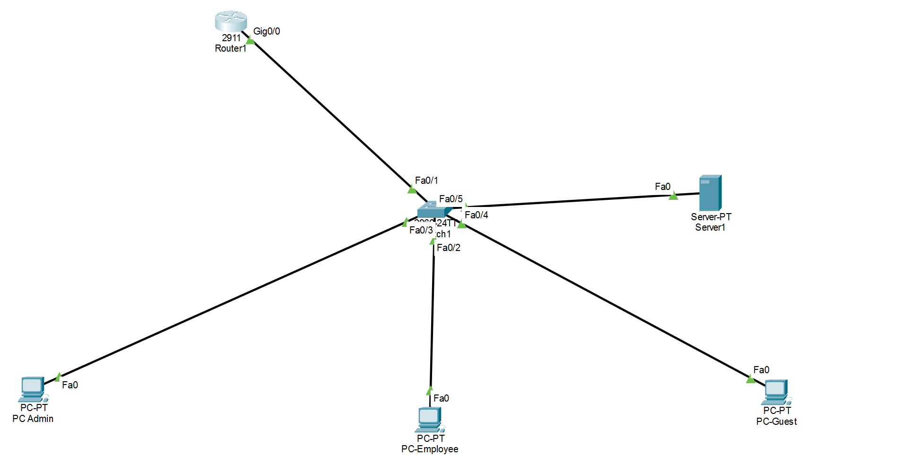
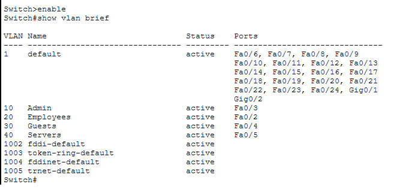
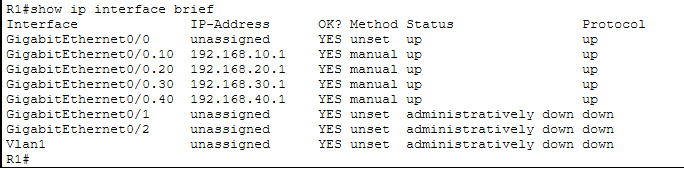
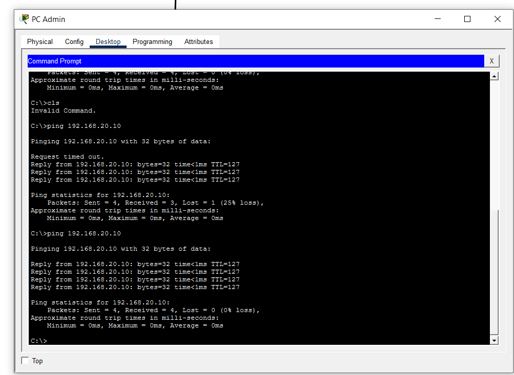
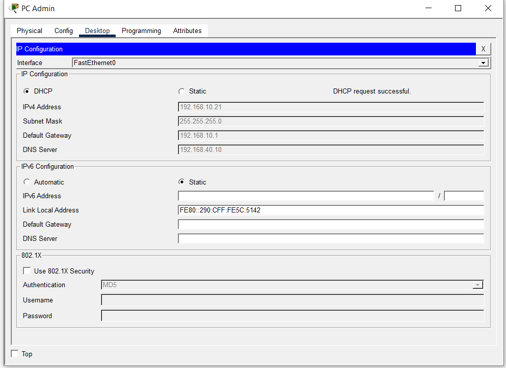
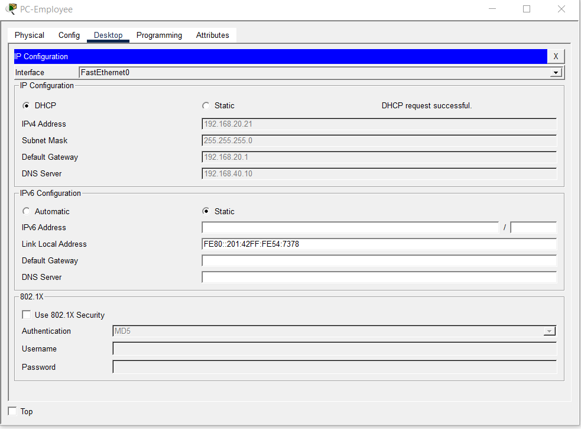
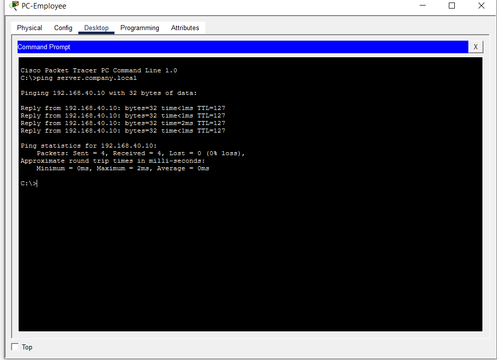
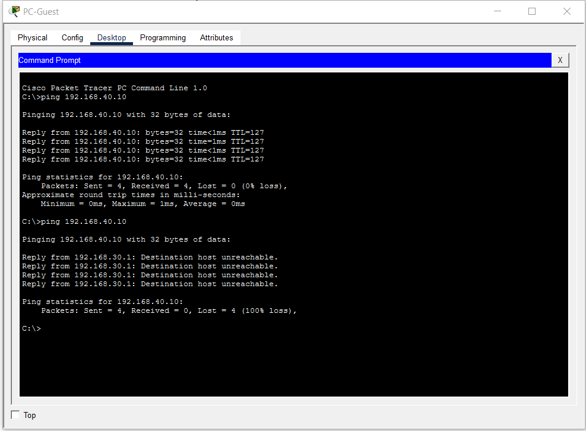
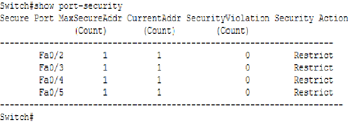
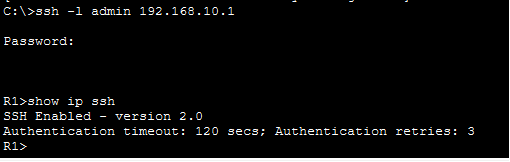

# Segmented Company Network (Cisco Packet Tracer)

A small-company network lab built in Cisco Packet Tracer. It separates four departments with VLANs, routes between them, and restricts guest access.

## Network overview

| Department | VLAN | Network | Gateway | Switch port |
| --- | --- | --- | --- | --- |
| Admin | 10 | 192.168.10.0/24 | 192.168.10.1 | Fa0/3 |
| Employees | 20 | 192.168.20.0/24 | 192.168.20.1 | Fa0/2 |
| Guests | 30 | 192.168.30.0/24 | 192.168.30.1 | Fa0/4 |
| Servers | 40 | 192.168.40.0/24 | 192.168.40.1 | Fa0/5 |

Devices: 1 router (Cisco 2911), 1 switch (Cisco 2960), 3 PCs, 1 server. Fa0/1 on the switch is the trunk to the router.

## What I implemented

- **VLANs and trunking:** four VLANs, access ports per department, 802.1Q trunk to the router.
- **Inter-VLAN routing:** router-on-a-stick with one sub-interface per VLAN.
- **DHCP:** pools for Admin, Employees and Guests on the router, with excluded address ranges for fixed devices; Server1 uses a static address.
- **DNS:** A record `server.company.local` -> 192.168.40.10 on Server1.
- **ACL:** extended ACL `GUEST-RESTRICT` blocks the Guests network from Admin, Employees and Servers, applied inbound on the guest sub-interface.
- **Port Security:** maximum 1 MAC address per port, sticky learning, `restrict` violation mode on Fa0/2 to Fa0/5.
- **SSH:** SSH version 2 on the router with a local account; Telnet disabled on the VTY lines.

## Verification

| Test | Evidence |
| --- | --- |
| VLANs and port assignment |  |
| Router sub-interfaces up |  |
| Inter-VLAN ping (Admin to Employee) |  |
| DHCP lease on Admin |  |
| DHCP lease on Employee |  |
| DNS name resolution |  |
| Guest blocked from server (before and after ACL) |  |
| Port Security status |  |
| SSH login and `show ip ssh` |  |

## Troubleshooting notes

- Admin and Employee PCs were connected to switch ports different from the plan, which broke pings to the gateway. I corrected the VLAN assignment on the two ports and verified with `show vlan brief`.
- The first ping after configuration can fail while ARP resolves the gateway MAC address.

## Limitations

- No NAT or internet connection.
- Guests are also blocked from the DNS server; allowing UDP port 53 before the deny rules would fix this.
- SSH is configured on the router only, not on the switch.
- This is a lab with a 1024-bit RSA key and a lab-only password; production use would need stronger settings.

## How to open

Download `Company-Network-Project.pkt` and open it with Cisco Packet Tracer.

## Author

Abdulaziz Al-Malki, cybersecurity diploma graduate. [LinkedIn](https://www.linkedin.com/in/abdalaziz-yahi)
